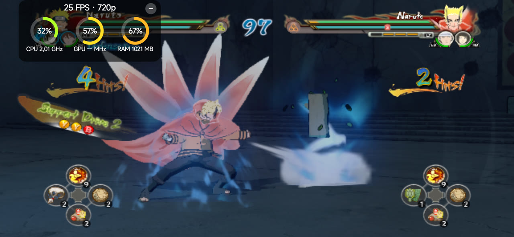
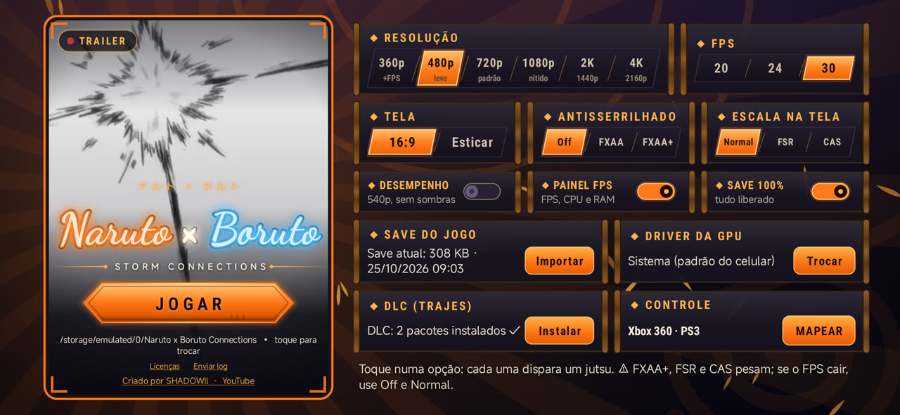
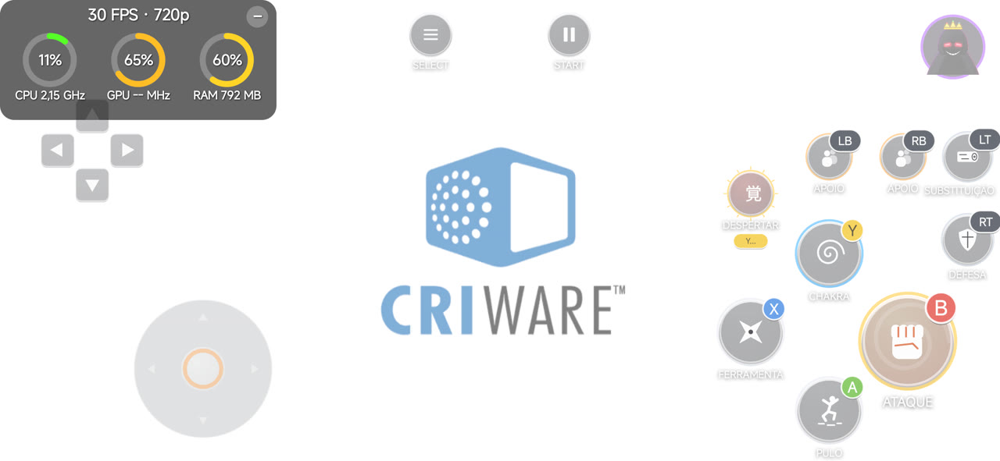

<div align="center">


# 🍥 Naruto x Boruto: Ultimate Ninja Storm Connections — Port Nativo

**O Storm Connections (mod do Storm Revolution de Xbox 360) rodando nativamente no Android (ARM64), sem emulador de CPU e com renderizador nativo.**


[Sobre](#-sobre) · [Recursos](#-o-que-o-port-oferece) · [Requisitos](#-requisitos) · [Versão do jogo](#-versão-do-jogo-obrigatória) · [Controles](#-controles) · [Perguntas](#-perguntas-frequentes)

</div>

---

## 📖 Sobre

Este port **não é um emulador de Xbox 360**. O executável do jogo (`default.xex`) é **recompilado estaticamente** de PowerPC para ARM64: o resultado é código nativo, que roda direto no processador do celular.

A parte gráfica usa o **shadowZero**, um renderizador nativo que pega os comandos Direct3D do jogo e desenha direto em Vulkan, sem emular a GPU do Xbox 360. Isso deixa o jogo bem mais leve e permite escolher a resolução interna de **360p até 4K**.

> [!IMPORTANT]
> **Nada do jogo é distribuído aqui.** Você precisa da sua **própria cópia** do jogo, na versão indicada em [Versão do jogo](#-versão-do-jogo-obrigatória). O *Storm Connections* é um mod de terceiros do *Storm Revolution* e também não faz parte deste projeto.

> [!NOTE]
> **Estado: em desenvolvimento.** O APK ainda **não foi liberado** ao público. Quando sair, ele aparece na página de **Releases**.

<div align="center">

</div>

## ✨ O que o port oferece

- Recompilação estática do jogo para **ARM64**, sem interpretador de CPU.
- Renderizador nativo **shadowZero** (Direct3D → Vulkan), com resolução interna de **360p, 480p, 720p, 1080p, 2K e 4K**.
- **30 FPS fixos** (ou 20 / 24 para aliviar aparelhos mais fracos) e **modo desempenho**.
- **Controles na tela** no formato do controle do Xbox (Y, X, B, A), com a **letra de cada botão** e um botão de **Despertar**; editor para mover, redimensionar e ajustar a transparência.
- **Controle físico automático:** plugou um controle (Xbox 360, PS3 e outros), os botões da tela somem; tirou, eles voltam. A opção **Toque + controle** (no emblema do Shadow) mantém os dois.
- **Save 100%** embutido (tudo liberado), que guarda o seu save e o devolve ao desligar.
- **DLC (trajes)** reconhecida na pasta do jogo e instalada sozinha.
- **Drivers de GPU customizados (Turnip)** em celulares **Snapdragon**, usados também pelo renderizador nativo.
- Painel de desempenho (FPS, resolução, CPU, GPU e RAM) e botão de enviar log.

<div align="center">

<br><br>

</div>

## 📱 Requisitos

| | Mínimo | Recomendado |
|---|---|---|
| **Android** | 11 (API 30) | 13 ou mais novo |
| **Processador** | ARM64 (arm64-v8a) | Snapdragon 7 Gen 1 / Dimensity 8000 ou superior |
| **GPU** | Vulkan 1.1 com *buffer device address* | Mali-G710 / Adreno 730 ou superior |
| **RAM** | 4 GB | 8 GB ou mais |
| **Espaço** | uns 7 GB para os arquivos do jogo | — |

**GPUs que funcionam:** Mali Valhall (G57, G68, G77, G78, G610, G710, G615, G720…), Adreno 6xx com Android 11 ou mais novo, Adreno 7xx e Xclipse. Mali antigas (T7xx/T8xx), Adreno 5xx e PowerVR (Helio A22/P35/G35/G37, Unisoc) **não** têm o recurso que o renderizador nativo usa: nelas o jogo muda sozinho para um modo de compatibilidade, mais pesado.

### Aparelhos testados

| Aparelho | Chip / GPU | Resultado |
|---|---|---|
| POCO X7 Pro | Dimensity 8400 / Mali-G720 | lutas a 30 FPS em 720p |
| Redmi 15 | Snapdragon 680 / Adreno 610 | lutas a 30 FPS em 480p |
| Galaxy Tab A9 | Helio G99 / Mali-G57 | lutas a 30 FPS em 360p |

## 💿 Versão do jogo (obrigatória)

O port é feito para **um executável específico**: o `default.xex` do *Storm Connections*. O código é recompilado a partir dele, então o arquivo precisa ser **idêntico** (confira o hash).

| Campo | Valor |
|---|---|
| Jogo | Naruto x Boruto: Ultimate Ninja Storm Connections (mod do Storm Revolution, Xbox 360) |
| Title ID | `4E4D0868` |
| Media ID | `29E320A9` |
| Versão do executável | `0.0.2.4` |

| Arquivo | Tamanho | SHA-1 | MD5 |
|---|---|---|---|
| `default.xex` | 4.448.256 bytes | `56ad0c6a81071eb2b5188b5ab556adf4ce138563` | `2ba1e1611aa944d80fc9aa47174e5c06` |

<details>
<summary><b>Como conferir o hash</b></summary>

- **Windows (PowerShell):** `Get-FileHash default.xex -Algorithm SHA1`
- **Linux / macOS:** `sha1sum default.xex`
- **Android:** qualquer app de "hash checker" da Play Store.

</details>

A pasta do jogo fica assim (a DLC é opcional; o menu a instala sozinho se estiver lá):

```
Pasta do jogo/
├── default.xex
├── data/
├── nxeart
└── Content/0000000000000000/4E4D0868/00000002/   (DLC de trajes)
```

## 🎮 Controles

| Botão na tela | Controle | Ação no jogo |
|---|---|---|
| ATAQUE | B | ataque |
| PULO | A | pulo |
| FERRAMENTA | X | ferramenta ninja |
| CHAKRA | Y | carregar chakra |
| DEFESA | RT | defesa |
| SUBSTITUIÇÃO | LT | substituição |
| APOIO | LB / RB | personagens de apoio |
| DESPERTAR | segurar Y | despertar (quando a barra permitir) |
| SELECT / START | Back / Start | menu e pausa |

O mapeamento de controles físicos pode ser mudado no menu, em **Controle → MAPEAR**.

## ❓ Perguntas frequentes

<details>
<summary><b>Quando sai o download?</b></summary>

Ainda não há data. Quando o APK for liberado, ele será publicado em **Releases** com as instruções de instalação.

</details>

<details>
<summary><b>Funciona com o Storm Revolution original ou com outro mod?</b></summary>

Não. Só com o `default.xex` do *Storm Connections* com o hash da tabela. Outro executável é outro programa e precisaria ser recompilado.

</details>

<details>
<summary><b>O código-fonte está disponível?</b></summary>

Este repositório traz só a documentação. Os componentes de código aberto usados (incluindo os de licença GPL-3.0 do renderizador nativo) estão listados abaixo, com as respectivas licenças.

</details>

## 🙏 Créditos

Este projeto só foi possível graças a estes projetos de código aberto:

- [**XenonRecomp**](https://github.com/hedge-dev/XenonRecomp): recompilador estático de PowerPC (Xbox 360)
- [**reNut**](https://github.com/masterspike52/reNut) e os ports [masseffect-nx](https://github.com/nebadasSwifty/masseffect-nx), [nfsmw-nx](https://github.com/StevensND/nfsmw-nx), banjo-nx e sa2-nx: base do renderizador nativo shadowZero
- [**plume**](https://github.com/renderbag/plume) e [**XenosRecomp**](https://github.com/hedge-dev/XenosRecomp): camada Vulkan e tradução dos shaders do Xbox 360
- [**Xenia Canary**](https://github.com/xenia-canary/xenia-canary): referência do hardware do Xbox 360 e modo de compatibilidade
- [**SDL 3**](https://github.com/libsdl-org/SDL): janela, entrada e áudio
- [**FFmpeg**](https://ffmpeg.org): decodificação de áudio XMA
- [**libadrenotools**](https://github.com/bylaws/libadrenotools): drivers de GPU customizados no Android
- Ao autor do mod *Storm Connections*, que não tem relação com este port

As licenças completas estão em [THIRD_PARTY_NOTICES.md](THIRD_PARTY_NOTICES.md).

## ⚖️ Aviso legal

Este é um projeto de fãs, **sem fins lucrativos**, sem nenhuma ligação com a Bandai Namco, a CyberConnect2, a VIZ Media, Masashi Kishimoto, a Microsoft ou o autor do mod. *Naruto*, *Boruto* e *Naruto Shippuden: Ultimate Ninja Storm Revolution* são marcas e obras de seus respectivos donos.

Os pacotes **não incluem** arquivos, vídeos, sons ou texturas do jogo nem do mod: é preciso ter a sua própria cópia. Não peça nem compartilhe arquivos do jogo nas issues.

---

<div align="center">
Feito com 🧡 por <a href="https://www.youtube.com/@Ll_Shadowll">SHADOWll</a>
</div>
