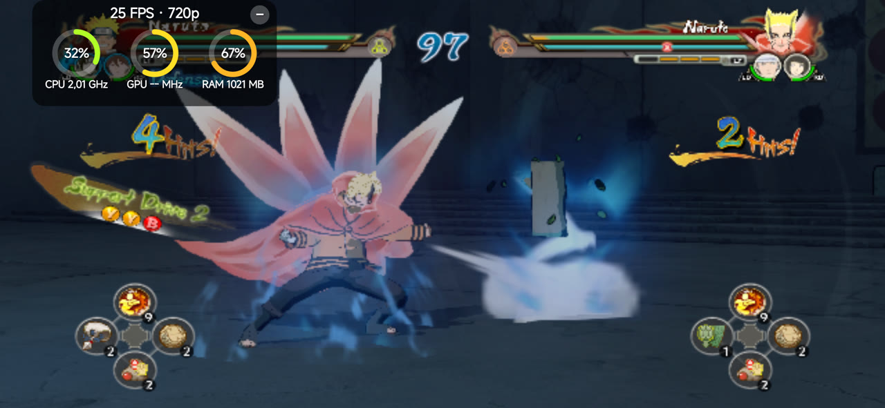
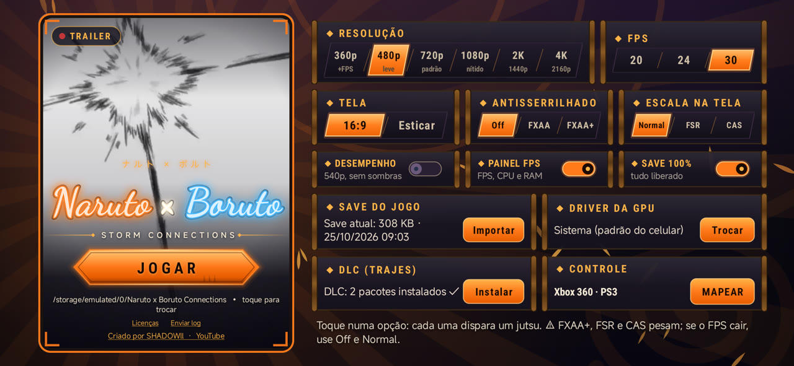
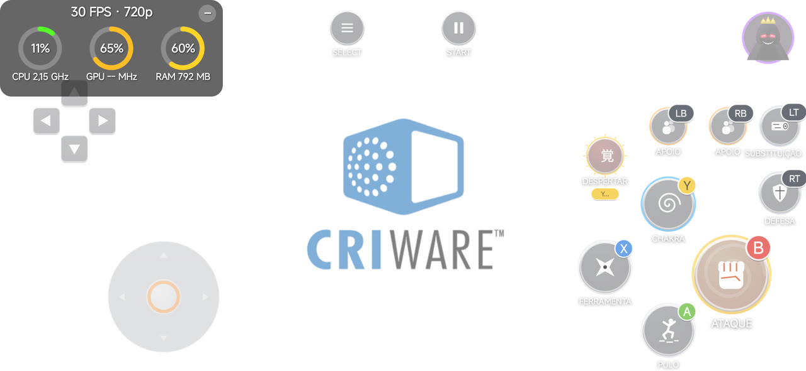

<div align="center">

  

  <h1>🍥 Naruto x Boruto: Ultimate Ninja Storm Connections — Port Native</h1>
  <p><em>Storm Connections (mod dari Storm Revolution, Xbox 360) berjalan <strong>natively</strong> di Android (ARM64) — tanpa emulator CPU, dengan renderer native.</em></p>

  <p>
    
    
    
    
    
  </p>

  <p>
    <a href="#tentang">Tentang</a> ·
    <a href="#fitur">Fitur</a> ·
    <a href="#unduh">Unduh</a> ·
    <a href="#requisit">Requisit</a> ·
    <a href="#versi-game-wajib">Versi Game</a> ·
    <a href="#kontrol">Kontrol</a> ·
    <a href="#faq">FAQ</a>
  </p>

</div>

---

## 📖 Tentang

Port ini **bukan emulator Xbox 360**. Eksekutabel game (`default.xex`) **dikompilasi ulang secara statis** dari PowerPC ke ARM64: hasil akhirnya kode native yang berjalan langsung di prosesor HP, bukan diinterpretasikan.

Bagian grafis memakai **shadowZero**, renderer native yang menerjemahkan perintah Direct3D dari game langsung ke Vulkan — tanpa mengemulasikan GPU Xbox 360. Ini membuat game jauh lebih ringan dan memungkinkan resolusi internal dipilih dari **360p sampai 4K**.

> [!IMPORTANT]
> **Tidak ada file game yang didistribusikan di sini.** Anda perlu **salinan game sendiri**, dalam versi yang tercantum di [Versi Game](#versi-game-wajib). *Storm Connections* adalah mod pihak ketiga dari *Storm Revolution* dan juga bukan bagian dari proyek ini.

> [!WARNING]
> **Versi uji.** APK tersedia di halaman [**Releases**](../../releases). Masih bisa bermasalah atau glitch gambar; laporkan di *Issues* dengan menyertakan perangkat dan resolusi yang digunakan.

<div align="center">
  
</div>

## ✨ Fitur

- **Rekompilasi statis ke ARM64** — tanpa interpretor CPU.
- **Renderer native shadowZero** (Direct3D → Vulkan), resolusi internal **360p / 480p / 720p / 1080p / 2K / 4K**.
- **30 FPS tetap** (atau 20 / 24 untuk perangkat yang lebih lemah) dan **mode performa**.
- **Kontrol di layar** bergaya kontrol Xbox (Y, X, B, A) dengan **huruf tiap tombol**, tombol **Awakening (Despertar)**, dan pintasan jutsu / jutsu rahasia / advance; **editor** untuk memindah, mengubah ukuran, dan mengatur transparansi.
- **Kontrol fisik otomatis**: saat kontrol dicolokkan (Xbox 360, PS3, dsb.), kontrol layar otomatis hilang; dilepas, muncul lagi. Opsi **Sentuh + Kontrol** (di emblem Shadow) mengaktifkan keduanya sekaligus.
- **Save 100% terintegrasi** (semua terbuka), menyimpan save Anda dan mengembalikannya saat ditutup.
- **DLC (kostum)** terdeteksi di folder game dan dipasang otomatis.
- **Frame Generation (AMD FG)**: Off / 2x / 3x / 4x. Game berjalan 30 FPS, layar menerima 60, 90, atau 120 frame/detik. Mode **Performa** (ringan, seperti Storm 4 PC) atau **Kualitas**, dan **Layar (Hz)** Auto / 60 / 90 / 120. Dibangun di atas flow optik AMD yang diadaptasi untuk HP (Mali, Adreno, Xclipse), tanpa file eksternal.
- **Tanpa freeze di ARM**: cincin perintah GPU yang mengunci game setelah beberapa menit (kadang dengan error `0x0BADF00D`) di HP dan tablet sudah diperbaiki.
- **Android 11 & 12**: app tidak lagi tertutup saat dibuka dengan internet menyala.
- **Pembaruan otomatis**: saat membuka menu, app memberi tahu jika ada versi baru di GitHub dan langsung mengunduh & memasang.
- **Driver GPU kustom (Turnip)** di ponsel **Snapdragon**, juga dipakai oleh renderer native.
- **Panel performa** (FPS, resolusi, CPU, GPU, RAM) dan tombol kirim log.

<div align="center">
  <br><br>
  
</div>

## ⬇️ Unduh

APK tersedia di halaman [**Releases**](../../releases).

1. Install APK.
2. Salin folder game (berisi `default.xex`) ke HP.
3. Buka app, ketuk jalur folder di bawah **JOGAR** (Play) untuk memilih folder game, dan beri izin akses file.
4. Ketuk **JOGAR**. Jika DLC ada di folder, akan dipasang otomatis.

## 📱 Requisit

| | Minimum | Rekomendasi |
|---|---|---|
| **Android** | 11 (API 30) | 13 atau lebih baru |
| **Prosesor** | ARM64 (arm64-v8a) | Snapdragon 7 Gen 1 / Dimensity 8000 atau lebih tinggi |
| **GPU** | Vulkan 1.1 dengan *buffer device address* | Mali-G710 / Adreno 730 atau lebih tinggi |
| **RAM** | 4 GB | 8 GB atau lebih |
| **Ruang** | ±7 GB untuk file game | — |

**GPU yang didukung:** Mali Valhall (G57, G68, G77, G78, G610, G710, G615, G720…), Adreno 6xx di Android 11+, Adreno 7xx, dan Xclipse. Mali lama (T7xx/T8xx), Adreno 5xx, dan PowerVR (Helio A22/P35/G35/G37, Unisoc) **tidak** memiliki fitur yang dipakai renderer native: di perangkat tersebut, game otomatis beralih ke mode kompatibilitas yang lebih berat.

### Perangkat yang sudah diuji

| Perangkat | Chip / GPU | Hasil |
|---|---|---|
| POCO X7 Pro | Dimensity 8400 / Mali-G720 | pertarungan 30 FPS di 720p |
| Redmi 15 | Snapdragon 680 / Adreno 610 | pertarungan 30 FPS di 480p |
| Galaxy Tab A9 | Helio G99 / Mali-G57 | pertarungan 30 FPS di 360p |

## 💿 Versi Game (Wajib)

Port ini dibuat untuk **satu eksekutabel tertentu**: `default.xex` dari *Storm Connections*. Kode di-rekompile dari file tersebut, jadi file harus **identik** (periksa hash-nya).

| | |
|---|---|
| **Game** | Naruto x Boruto: Ultimate Ninja Storm Connections (mod dari Storm Revolution, Xbox 360) |
| **Title ID** | `4E4D0868` |
| **Media ID** | `29E320A9` |
| **Versi Eksekutabel** | `0.0.2.4` |

| File | Ukuran | SHA-1 | MD5 |
|---|---|---|---|
| `default.xex` | 4.448.256 byte | `56ad0c6a81071eb2b5188b5ab556adf4ce138563` | `2ba1e1611aa944d80fc9aa47174e5c06` |

<details>
<summary><b>Cara memeriksa hash</b></summary>

- **Windows (PowerShell):** `Get-FileHash default.xex -Algorithm SHA1`
- **Linux / macOS:** `sha1sum default.xex`
- **Android:** gunakan app "hash checker" mana pun dari Play Store.

</details>

Struktur folder game (DLC opsional; jika ada di situ, menu akan memasangnya otomatis):

```
Folder-game/
├── default.xex
├── data/
├── nxeart
└── Content/0000000000000000/4E4D0868/00000002/   (DLC kostum)
```

## 🎮 Kontrol

| Tombol di Layar | Kontrol | Aksi di Game |
|---|---|---|
| **ATAQUE** | B | serangan |
| **PULO** | A | lompat |
| **FERRAMENTA** | X | senjata ninja |
| **CHAKRA** | Y | mengisi chakra |
| **DEFESA** | RT | bertahan |
| **SUBSTITUSI** | LT | pergantian |
| **APOIO** | LB / RB | karakter pendukung |
| **DESPERTAR** | analog kanan ke samping | awakening (jika bar mengizinkan) |
| **JUTSU / OUGI / AVANÇO** | Y B / Y Y B / Y A | jutsu, jutsu rahasia, advance |
| **SELECT / START** | Back / Start | menu dan pause |

Pemetaan kontrol fisik bisa diubah di menu, pada **Kontrol → MAPEAR**.

## ❓ FAQ

<details>
<summary><b>Di mana unduhannya?</b></summary>

Di halaman [**Releases**](../../releases). Lihat rilis dari versi masing-masing.

</details>

<details>
<summary><b>Bisa pakai Storm Revolution asli atau mod lain?</b></summary>

Tidak. Hanya `default.xex` dari *Storm Connections* dengan hash sesuai tabel. Eksekutabel lain adalah program berbeda dan perlu direkompilasi.

</details>

<details>
<summary><b>Apakah sumber kodenya tersedia?</b></summary>

Repositori ini hanya berisi dokumentasi. Komponen open source yang dipakai (termasuk dari lisensi GPL-3.0 milik renderer native) tercantum di bawah, lengkap dengan lisensinya masing-masing.

</details>

## 🙏 Kredit

Proyek ini bisa ada berkat proyek open source berikut:

- [**XenonRecomp**](https://github.com/hedge-dev/XenonRecomp): perekompilasi statis PowerPC (Xbox 360)
- [**AMD FidelityFX SDK**](https://github.com/GPUOpen-LibrariesAndSDKs/FidelityFX-SDK) (MIT): flow optik dan interpolasi untuk frame generation
- [**reNut**](https://github.com/masterspike52/reNut) dan port [masseffect-nx](https://github.com/nebadasSwifty/masseffect-nx), [nfsmw-nx](https://github.com/StevensND/nfsmw-nx), banjo-nx, dan sa2-nx: basis renderer native shadowZero
- [**plume**](https://github.com/renderbag/plume) dan [**XenosRecomp**](https://github.com/hedge-dev/XenosRecomp): lapisan Vulkan dan terjemahan shader Xbox 360
- [**Xenia Canary**](https://github.com/xenia-canary/xenia-canary): referensi hardware Xbox 360 dan mode kompatibilitas
- [**SDL 3**](https://github.com/libsdl-org/SDL): jendela, input, dan audio
- [**FFmpeg**](https://ffmpeg.org): dekoding audio XMA
- [**libadrenotools**](https://github.com/bylaws/libadrenotools): driver GPU kustom di Android
- Ke pembuat mod *Storm Connections*, yang tidak berafiliasi dengan port ini

Lisensi lengkap ada di [THIRD_PARTY_NOTICES.md](THIRD_PARTY_NOTICES.md).

## ⚖️ Keterangan Hukum

Ini adalah proyek penggemar, **nirlaba**, tanpa afiliasi dengan Bandai Namco, CyberConnect2, VIZ Media, Masashi Kishimoto, Microsoft, atau pembuat mod tersebut. *Naruto*, *Boruto*, dan *Naruto Shippuden: Ultimate Ninja Storm Revolution* adalah merek dan karya milik pemegang hak masing-masing.

Paket **tidak** menyertakan file, video, audio, atau tekstur game maupun mod: Anda perlu memiliki salinan sendiri. Jangan meminta atau membagikan file game di issues.

---

<div align="center">
  Dibuat dengan 🧡 oleh <a href="https://www.youtube.com/@Ll_Shadowll">SHADOWll</a>
</div>
